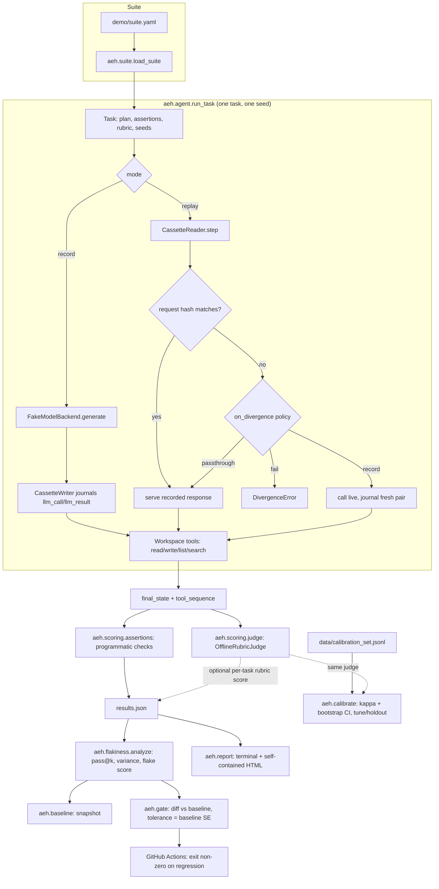

# Architecture

## Module map

| Module | Responsibility |
|---|---|
| `aeh.events` | Canonical `TrajectoryEvent`, JSONL (de)serialization, content hashing |
| `aeh.cassette` | `CassetteWriter` (recording journal), `CassetteReader` (replay + divergence detection) |
| `aeh.backends.fake` | Deterministic, seeded, offline model backend |
| `aeh.backends.gemini` | Real Vertex AI Gemini backend; lazy client construction, never required for tests |
| `aeh.workspace` | In-memory virtual filesystem + the demo agent's four tools + their JSON-schema `TOOL_SPECS` |
| `aeh.suite` | YAML task suite loader |
| `aeh.agent` | The run loop: ties backend + tools + journal together for one task/seed |
| `aeh.scoring.assertions` | Programmatic checks: final state, tool path (`exact`, `subsequence`, `set`, `required_tools`), forbidden actions |
| `aeh.scoring.judge` | Judge protocol, `OfflineRubricJudge`, `GeminiJudge` with selectable prompt versions |
| `aeh.calibrate` | Judge-vs-human agreement: raw agreement, Cohen's kappa, bootstrap interval, confusion matrix, tune/holdout splits |
| `aeh.metrics` | Token and dollar pricing, percentiles, per-task and per-suite cost/latency rollups |
| `aeh.flakiness` | pass@k, variance, flake score, ranked by flakiness |
| `aeh.baseline` | Save/load a "known good" result snapshot |
| `aeh.gate` | Diff a run against a baseline with per-task noise tolerance; exit code for CI |
| `aeh.report` | Terminal report + self-contained single-file HTML report |
| `aeh.cli` | `aeh record\|replay\|run\|report\|calibrate\|baseline\|gate` |

## Data flow, in one sentence

A suite YAML becomes tasks; each task/seed run either records a cassette
(live fake backend + tools, journaled) or replays one (served from the
cassette, with request-hash verification); every run's final state is
scored by assertions (and optionally the offline judge); many seeds per
task feed flakiness analysis; a saved baseline plus a fresh flakiness
analysis feed the regression gate; and everything renders to a terminal
report and a self-contained HTML report.
